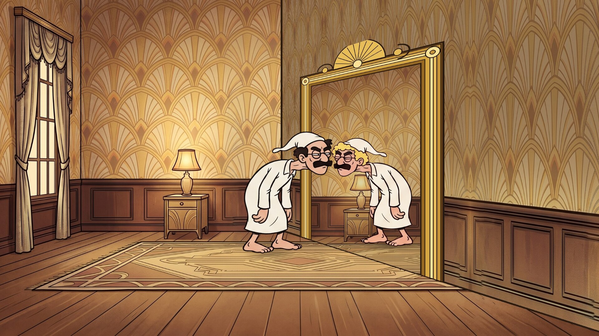
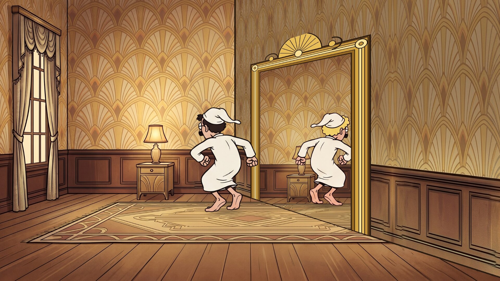
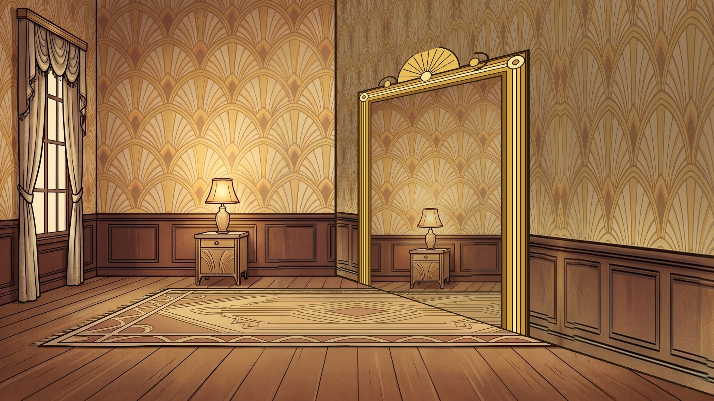
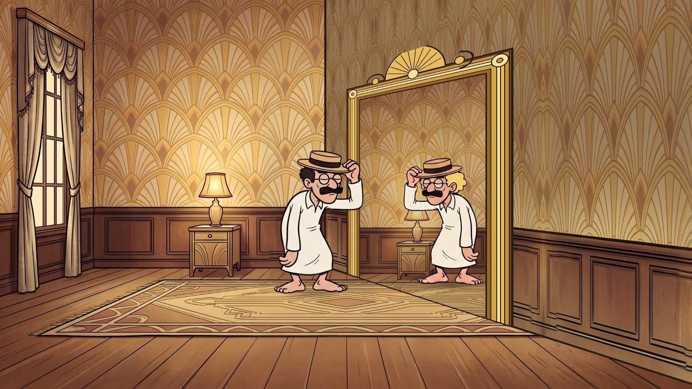
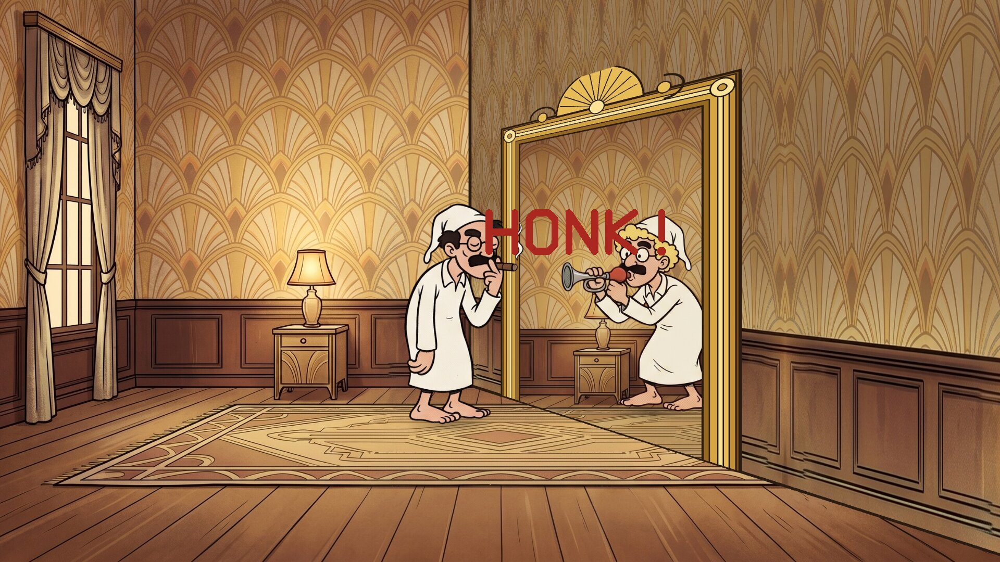
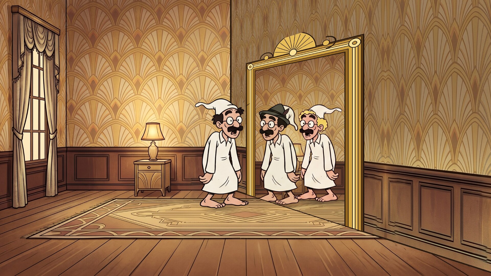

# The Mirror Scene

A cartoon screensaver of the mirror gag: a man in a nightshirt creeps up to a mirror
whose glass is gone, and the man on the other side copies everything he does,
almost. Runs on Linux, Windows and macOS. One of the
[Marx Brothers screensavers](https://github.com/mottipython/marx-screensavers).

## The gag

It is a homage to the mirror scene in the Marx Brothers' *Duck Soup* (1933), in
which Groucho, in nightshirt and nightcap, catches what he takes for his reflection
in a broken mirror, and it is really Harpo in the same disguise, copying him move
for move. Neither will admit it. He ducks, it ducks; he spins round, it spins round.
Then Chico walks in, dressed the same.

## What the screensaver shows

One round takes about a minute, and then it starts again with the dance in a new
order.

| | |
|---|---|
|  |  |
| He peers into the frame, and so does the reflection | A sudden turn, to catch it out; it is a little slow |
|  |  |
| He steps away, and the reflection is gone too, until he peeks back | The other one drops a hat. He has none to drop, but he picks one up anyway |
|  |  |
| A giveaway | And a third man walks through the frame |

They walk in from either side, peer, duck and spin; one walks off and peeks back;
there is a six-move dance in which the reflection is late once and gets a double
take; the hats; the horn; each walks right through the frame to the other side and
back; and the third man arrives to shrug between them.

### How the mirror is done

The frame stands in a wall seen at an angle, and the room beyond it is the room
in front, turned the other way round, as a mirror would show it: the lamp on the
left is seen on the right through the frame. The "reflection" stands beyond the
wall, so he is only ever seen through the frame, a little further off and a little
smaller, and when he steps aside the wall hides him. His every move is the first
man's, a moment later, and he is Harpo: blond curls show under his nightcap. He is drawn in
every one of the first man's poses, from the same character sheet redrawn with him
(`assets/PROMPTS.md`). `tools/compose_room.py` builds the room from a drawing of the
room alone, and draws the gilt frame.

## Install

Packages are on the [releases page](../../releases).

### Windows

Run `MirrorScene-Setup-0.1.0.exe`. It asks for administrator rights, because Windows
only lists screensavers that are in its own system folder. After that "The Mirror
Scene" is in Screen Saver Settings with the others, already selected. Uninstall from
Apps.

### macOS

For Apple Silicon and Intel, macOS 11 or later. The quick way is to paste this into
Terminal. It installs the screen saver for your user and opens the Screen Saver
settings, where it is at the end of the list:

    curl -fsSL https://raw.githubusercontent.com/mottipython/marx-screensavers/main/tools/mac-install.sh | sh -s -- mirror-scene

Put `--uninstall` in place of `mirror-scene` to take it off again.

To do it by hand, download the file ending `-mac-screensaver.zip` from the releases
page, unzip it and double-click the `.saver` file. It is not signed with an Apple
developer certificate, so macOS will refuse it at first: open System Settings,
Privacy & Security, and click Open Anyway. (The command above avoids that step.)
The file ending `-mac.zip` is the same thing as an ordinary app that runs full
screen until you press a key.

### Linux

**Fedora, Nobara** (built on Fedora 44):

    sudo dnf install ./mirror-scene-0.1.0-1.fc44.x86_64.rpm

**Debian, Ubuntu, Mint** (Ubuntu 24.04 / Debian 13 or later):

    sudo apt install ./mirror-scene_0.1.0_amd64.deb

From your next login it starts by itself after five minutes idle, and any key or
mouse movement ends it. To start the watcher without logging out, or to change the
delay:

    mirror-scene-screensaver enable 10    # after 10 minutes idle
    mirror-scene-screensaver disable
    mirror-scene-screensaver status
    mirror-scene-screensaver now          # run it right away

Wayland desktops have no screensaver service to plug into, so the package starts a
small idle watcher (`swayidle`) at login. It works on compositors that provide the
ext-idle-notify protocol: KDE Plasma, Sway, Hyprland, niri, COSMIC, labwc and
others. GNOME does not provide it, and on X11 you would add `mirror-scene` to
xscreensaver or your desktop's own idle settings. It does not lock the screen.

If [screensaver-service](https://github.com/mottipython/screensaver-service) is
installed, The Mirror Scene appears in its list of screen savers, and that service
starts it in place of the watcher described above.

## Running it yourself

    mirror-scene              full screen on every display; any key or mouse movement quits
    mirror-scene --window     in a window; Esc or Q quits
    mirror-scene --speed 2    faster
    mirror-scene --seed 3     the same dance every time
    mirror-scene --snapshot out.bmp --time 30 --size 1920x1080

## Building

Needs a C compiler, make and SDL2 (2.0.18 or newer). Build from the top of the
source tree, because the pictures in `assets/art` are built into the program.

    make
    make check
    sudo make install

Packages are written to `dist/`. `tools/Containerfile` describes a container with
everything they need:

    podman build -t anathem-build -f tools/Containerfile tools
    podman run --rm --security-opt label=disable -v "$PWD":/src -w /src anathem-build make dist

The pictures in `assets/art` are made from the drawings by `tools/compose_room.py`
(the room and its mirror) and `tools/make_sprites.py` (cutting up the figure sheets).

## Credits and licence

MIT. An unofficial homage, not connected with the Marx Brothers' estate or with
Paramount; the characters are cartoons, not likenesses.

The room and the figures were drawn with Google Gemini. Images are decoded with
[stb_image](https://github.com/nothings/stb) (public domain).
